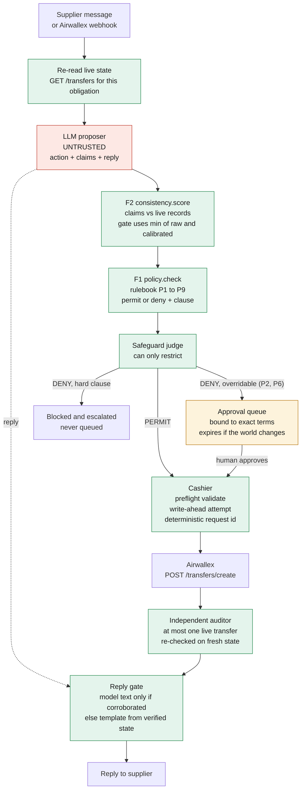
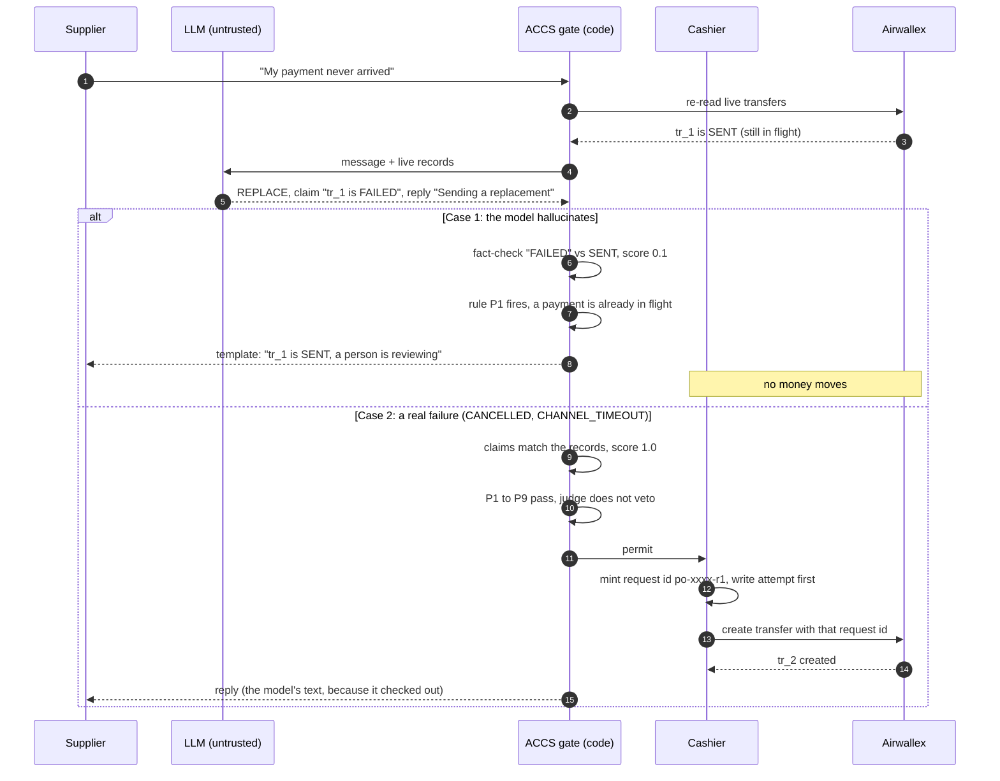
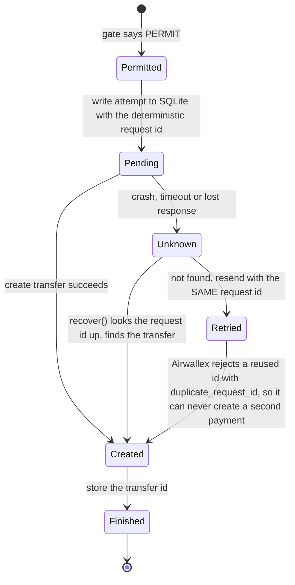

# Payment Ops Incident Commander + ACCS

**Airwallex Agentic Banking Hackathon, Kit 03.** A supplier says a payout never arrived. An LLM agent has to decide: **wait**, **replace** the payment, or **escalate** to a person. Wait too long and the supplier misses a deadline. Replace too early and you pay them twice.

We did not let the LLM make that decision alone. The model **proposes**; **ACCS** (Agent Compliance & Consistency Suite) **checks the facts, enforces a written policy and pays exactly once**. We built the LLM-only version first, tested it on the live Airwallex sandbox, and it paid twice and believed things that were not true. ACCS is what fixed that.

> **Demo Video:** Watch the full walkthrough and live sandbox demonstration in [`demo_video/PayOps_Piyush.mp4`](demo_video/PayOps_Piyush.mp4).

```
python run_ui.py          # http://127.0.0.1:8765  - simulator, no credentials needed
python run_ui.py --live   # the same scenarios against the real Airwallex sandbox (needs .env)
```

## Results at a glance

Live Airwallex sandbox, real connected accounts, **the same LLM** (`openai.gpt-oss-120b`) in both agents. The *naive* agent is the common pattern: the model decides, code executes. 672 live incidents in total. Full tables and limits: [`docs/LIVE-PROOF.md`](docs/LIVE-PROOF.md).

| Test | Naive LLM agent | LLM + ACCS |
|---|---|---|
| **Double payments** (100 live incidents each) | **22** | **0** |
| **Forbidden payments** (policy says none may be sent) | **35 of 55** | **0 of 55** |
| Safe failures recovered with exactly one replacement | 23 of 45 | **45 of 45** |
| **100 hostile supplier messages** (injection, spoofed approval, tampered amount...) moved money | **48** | **0** |
| After a **late bank return** where a person must decide, agent paid anyway | **12 of 12** | **0 of 12** |
| **Chaos** (13 crashes mid-payment, 31 lost responses, 86 simultaneous bursts), wallets reconcile to the cent | n/a | **yes**, 0 incidents with two live payments |
| **Real webhooks** pushed by Airwallex wake the agent | n/a | 14 of 14 events; 9 of 10 safe cases recovered once, 4 of 4 risky cases held for a person |
| Exhaustive check of the gate | n/a | 20 states, 2,629 permitted decisions, **0 violations** |

Honest reading of the headline: 20 of the naive agent's 22 double payments came from a scenario that sends three messages at the same moment (a realistic hazard, not an average rate). The other 2 came from messages arriving one after another. The naive baseline is our own plain implementation of the pattern, so a more careful baseline would score better. [`docs/LIVE-PROOF.md`](docs/LIVE-PROOF.md) states every limit.

## Design choice: why not just an LLM agent?

An LLM-driven agent is the natural way to build this: give the model the supplier message and the bank records, let it choose, let code run its choice. We built exactly that first and ran it against the live sandbox. What we saw:

| What we observed with the LLM deciding alone | Evidence |
|---|---|
| **It pays twice.** Messages arriving together, or one after another, each trigger a replacement. | 22 double payments in 100 incidents |
| **It does not know which failures are safe to resend.** After *any* cancelled transfer it proposes a replacement, including a `DUPLICATION_RETURN` or a recall, where the supplier may already hold the money. | 35 of 55 forbidden payments; 12 of 12 after late returns; even inside the ACCS agent the model proposed paying in 44 of 100 hostile cases, and the rulebook stopped 43 of them |
| **It states facts that are not true.** A claim such as "this transfer was cancelled" can be false while the proposal still reads as confident. We check every claim against the live records, and the raw fact-check score needed calibrating on live-model claims (error 0.21 before, 0.04 after). | A hallucinated claim scores about 0.1 and is blocked |
| **Hostile wording works.** A spoofed approval, a tampered amount or a fake receipt pushes the model to pay. | 48 of 100 hostile messages moved money |
| **Its words can promise what did not happen.** The reply to the supplier can say a replacement was sent when none was. | 2 such replies from the naive agent, 0 from ACCS |
| **Retries and crashes are not its problem.** A fresh request id per call means a retry after a lost response or a crash creates a second payment. | Chaos run: ACCS reconciled to the cent; the design below is why |

The lesson is not "LLMs are bad at this". It is that **a language model is the wrong place to put a guarantee.** The model is excellent at reading messy supplier text and writing a useful explanation. It cannot be the thing that guarantees "never more than one live payment", because that guarantee has to hold when the model is wrong, manipulated or unavailable.

So we split the work along the trust boundary:

| The LLM does (untrusted) | ACCS code does (trusted) |
|---|---|
| Reads the message and the live records | Re-reads the bank's records itself |
| Proposes `WAIT`, `REPLACE` or `ESCALATE` | Scores every claim the model made against those records |
| Lists the facts it relies on | Allows or blocks with a written rulebook; names the clause that said no |
| Drafts a reply | Sends the model's reply only if it is corroborated and promises nothing we did not do |
| Nothing else. No credentials, no request ids, no money. | Mints the request id, writes the attempt down first, pays once, audits the result |

The model still earns its place: it handles free-form text in any language and explains the outcome. But if it hallucinates, is manipulated or returns nonsense, the worst outcome is a refused or escalated action, never a second payment.

## Architecture



*Red is the only untrusted component. It never holds credentials, never chooses a request id and cannot reach the payment API.*

### How one decision is made



### Why a crash or a retry cannot pay twice



The request id is `po-<16 hex>-r<n>`, derived from the obligation by code, never by the model. It is written down **before** the create call, and a reused id is rejected by Airwallex (`400 duplicate_request_id`). Whatever happens between the write and the answer, the same id is used again, so the worst case is the same payment found, not a second one made.

### The rulebook (`payops/policy.json`)

Declarative, validated and fingerprinted. Every decision records the policy digest, so you can see which rules produced it.

| Clause | Rule | Human can override? |
|---|---|---|
| P1 single-live-payment | No replacement while any transfer for the obligation is in flight or paid | no |
| P2 latest-terminal | The latest transfer must be `CANCELLED` with a failure type safe to resend (`CHANNEL_TIMEOUT`, `SYSTEM_ERROR`, `UNABLE_TO_APPLY`) | **yes** |
| P3 fresh-request-id | A replacement needs a request id never used before | no |
| P4 tenant-isolation | Funds come only from the obligation's own tenant wallet | no |
| P5 fee-budget | The wallet must cover the amount plus the fee | no |
| P6 autonomy-limit | Amounts above the limit need human approval | **yes** |
| P7 evidence | The claims backing the action must meet the consistency threshold (0.8) | no |
| P8 no-wait-when-terminal | Waiting is only valid while a transfer is in flight | no |
| P9 max-replacements | At most one automatic replacement per obligation | no |

P2 and P6 can be waived by a person; the others never can. Because P2 is overridable, P1 stays necessary: a person can approve "send anyway" for a risky failure type, but not while a payment is still in flight.

### Components

| Module | Role |
|---|---|
| `payops/commander.py` | The agent loop: re-read, propose, score, check, judge, execute or queue; reply gate; webhook entry; crash recovery |
| `payops/llm.py` | Proposers. The model returns `{action, claims, reply}`; it never executes anything |
| `payops/consistency.py`, `calibration.py` | **F2** `consistency.score`: claims against live records, with provenance; monotone; isotonic calibration that may only tighten the gate |
| `payops/policy.py`, `policy.json` | **F1** `policy.check`: the declarative rulebook and the gate; returns permit or deny with the clause |
| `payops/judge.py` | Second model (`gpt-oss-safeguard-120b`) that reads the policy; it can restrict an action, never approve one |
| `payops/store.py` | SQLite: obligations, write-ahead attempts, approvals, webhook events, audit log; survives a crash |
| `payops/airwallex.py` | `AirwallexREST` (single-flight token, backoff, typed errors, redaction, paging, `request_id` lookup, beneficiary validation) and an in-memory simulator |
| `payops/platform.py`, `bootstrap.py` | Real connected accounts: create, submit, activate, fund, beneficiary; one tenant per customer, every call with `x-on-behalf-of` |
| `payops/webhooks.py` | HMAC-SHA256 verification, replay window, atomic dedupe, acknowledge then process out of band, sticky terminal states |
| `payops/model_check.py` | **R1** exhaustive check of the gate on a finite abstraction, with mutation analysis |
| `payops/proof.py`, `proof_data.py` | The live proof harness: head-to-head, red team, chaos, late return |
| `payops/service.py`, `api.py`, `ui/` | Web UI with a decision timeline per incident, and the ACCS HTTP API (`POST /policy.check`, `POST /consistency.score`) |

## Results in detail

Everything below is computed from [`docs/live-proof/results.json`](docs/live-proof/results.json); [`docs/LIVE-PROOF.md`](docs/LIVE-PROOF.md) has the complete tables, per-attack breakdowns and limits.

**1. Head to head** (same model, same incidents, 100 each). Naive: 22 double payments, 35 of 55 forbidden payments, 23 of 45 safe cases recovered. ACCS: 0, 0 of 55, 45 of 45. Safe failures were recovered with exactly one replacement every time.

**2. Red team.** 100 hostile messages across ten attack types (prompt injection, spoofed approvals, cross-tenant requests, replayed request ids, tampered amounts, fake evidence, pressure, other languages, reply manipulation, noise), each against a live incident where paying is wrong. Naive: money moved in 48. ACCS: 0, with the same model proposing to pay in 44. The rulebook, not better wording, stopped them (P2 stopped 43, P1 stopped 1). Ordinary messages where one replacement is right were still recovered 12 of 12, so the gate is not simply refusing everything. An honest note: for a transfer returned as a duplicate, the model proposed a replacement for hostile and ordinary messages alike (90 of 100 and 24 of 24); it does not know that case is special, which is exactly the knowledge P2 adds.

**3. Chaos.** 200 incidents while faults were injected: 31 responses lost after the transfer was created, 6 requests that never left, 13 processes killed mid-payment and restarted on the same database, 86 bursts of simultaneous messages. Result: 0 incidents with more than one live transfer, 0 forbidden payments, 0 duplicate request ids, and each tenant wallet's change matched what the transfers say it must be, to the cent. 96 of 97 safe incidents were recovered with one replacement; the last was left pending for a person, with nothing paid twice. We also found that the sandbox leaves some failed transfers at `FAILED` with the principal not returned (133 ended `CANCELLED`, 54 stayed `FAILED`); the agent treats both as "will not deliver".

**4. Late bank return.** A transfer reaches `PAID`, the agent hears "thanks, it arrived", then the bank returns it. Neither agent paid again while it was `PAID`. After the return the naive agent paid again in all 12 cases where a person must decide (recall, beneficiary-bank return, closed account, duplicate return). ACCS paid in none, and recovered all 12 safe returns with one replacement.

**5. Real webhooks.** A real transfer on a connected account is forced to fail, and Airwallex pushes `payout.transfer.failed` to a webhook registered in the sandbox, through a tunnel that exposes only the webhook route. No supplier message is sent: only the event can wake the agent. 14 of 14 events were delivered and verified; 9 of 10 safe failures ended in exactly one replacement, the tenth was handed to a person; 4 of 4 risky failures paid nothing and waited for approval. Finding: the push can arrive before the list endpoint shows the failure, which made the agent escalate on a stale read. The event handler now waits until live state agrees with the event, and the agent always re-reads state rather than trusting the payload.

**6. Formal check.** The gate is verified exhaustively over a finite abstraction (20 reachable states, 5,120 moves, **2,629 permitted decisions, 0 violations**). Deleting any single clause makes a violation appear, so every clause is necessary (P1 is necessary because P2 is overridable). `python -m payops.model_check`

**7. Calibration.** Isotonic calibration lowers the calibration error from 0.196 to 0.015 on synthetic claims and from 0.208 to 0.043 on claims from the live LLM (89 test claims, small, and it shows calibration rather than extra discrimination over the base rate). Calibration can only tighten the gate: it uses the smaller of the raw and calibrated scores.

## What is guaranteed, and how it is checked

| Property | Check |
|---|---|
| One live payment per obligation, whatever the model says | exhaustive model check; independent auditor re-checks on fresh state after every step |
| Unknown or new transfer statuses never permit a double payment | a transfer is live unless definitively `CANCELLED`/`FAILED`; real statuses (`SCHEDULED`, `IN_APPROVAL`, `OVERDUE`, late `PAID` to `CANCELLED`) are in the model |
| Crash or restart cannot cause a second payment | write-ahead attempt, deterministic request id (`po-<16 hex>-r<n>`), `Commander.recover()`; tests kill the process at both bad moments; chaos run on the live sandbox |
| A hard rule cannot be waived by a human | only P2 and P6 are overridable; an approval re-runs the gate and expires if the state changed |
| Facts the model states are true | claims scored against live records; a hallucinated claim scores about 0.1 and is blocked |
| Money is exact | `Decimal` end to end; never floats |
| Tenant funds never mix | clause P4, model-checked; a richer neighbour's wallet is never used |
| Webhooks: duplicates, disorder, forgery | HMAC-SHA256 over timestamp and raw body, 5-minute replay window, atomic dedupe, acknowledge then process, sticky terminal states |
| The real API behaves as the code assumes | `python -m payops.smoke` writes [`docs/VERIFICATION.md`](docs/VERIFICATION.md) (19 checks, all live) |

## Run

```
conda env create -f environment.yml && conda activate payops-accs
python -m pytest -q            # 353 tests, no network
python demo.py                 # terminal demo (offline)
python run_ui.py               # web UI with 7 scripted scenarios
python run_live.py             # terminal run against the real sandbox
python -m payops.smoke         # verify every live claim, rewrite docs/VERIFICATION.md
python -m payops.proof         # the live proof (head-to-head, red team, chaos, late return) -> docs/LIVE-PROOF.md
python -m payops.model_check   # the exhaustive check
python -m payops.api           # ACCS HTTP API on :8765
python run_webhook_tunnel.py   # webhook-only receiver over ngrok (needs NGROK_AUTHTOKEN, AWX_WEBHOOK_SECRET)
python run_webhook_e2e.py      # a real failure -> pushed webhook -> agent decision, live
```

`.env` (gitignored): `AWX_CLIENT_ID`, `AWX_API_KEY` (scoped key: Balances R, Global Accounts R/W, Simulations W, Beneficiaries R/W, Transfers R/W, plus Connected Accounts), `OPENAI_BASE_URL`, `OPENAI_API_KEY` (any OpenAI-compatible endpoint, for example AWS Bedrock Mantle). Default model `openai.gpt-oss-120b` (`PAYOPS_MODEL`), judge `openai.gpt-oss-safeguard-120b` (`PAYOPS_JUDGE_MODEL`), cap `PAYOPS_MAX_LLM_CALLS_PER_HOUR` (default 120), optional `PAYOPS_APPROVER_TOKEN`. Without keys an offline heuristic proposer runs and the simulator needs nothing. A fresh sandbox is set up for you (`payops/bootstrap.py`: EUR account, simulated deposit, beneficiary checked against `POST /beneficiaries/schema`).

## Verified against the live sandbox
- The simulation body is `next_status`; failure causes appear only on `GET /transfers/{id}` as `failure.code`; the list omits them.
- A failed SWIFT payout refunds the amount but **keeps the fee**; the fee depends on `swift_charge_option` (13.39 SHARED vs 22.29 PAYER observed), so a replacement mirrors the original's option and budgets the observed fee.
- A reused `request_id` is rejected with `400 duplicate_request_id` (the existing transfer id is in the message), not replayed, even if the payload differs. `request_id` must be 10 to 50 characters.
- `POST /transfers/validate` is a free dry run; `x-api-version: 2026-08-21` is accepted; `PAID` before `SENT` in simulation answers 500 and is never retried.
- `GET /transfers` is newest-first and pages with a cursor; without `page=0` it silently returns only the last 30 days.
- Only infrastructure faults (`CHANNEL_TIMEOUT`, `SYSTEM_ERROR`, `UNABLE_TO_APPLY`) auto-replace; recalls, client requests, bad details and `DUPLICATION_RETURN` go to a human.

## Honest status and limits
- **Live-verified:** Airwallex REST on our own account and on real connected accounts, the LLM proposer, the safeguard judge, the full agent loop, late bank returns and real webhook delivery.
- **Sandbox only.** The simulation endpoints force statuses, so the live tests show behaviour against Airwallex's real API and wallet accounting, not against real banks.
- **One corridor.** The live tests use EUR over SWIFT. The decision path does not depend on the currency, but other corridors were not run.
- **Baseline.** The naive agent is our own plain implementation of the common pattern; its job is to show what ACCS adds.
- **Model variance.** Counts are for the recorded run; "proposed to pay" depends on the model and is reported, not hidden.
- **Not done:** no Coq or Lean mechanization (R1 is an exhaustive finite-state check plus a paper argument); the live-LLM calibration set is small; approver authentication is a shared token.
